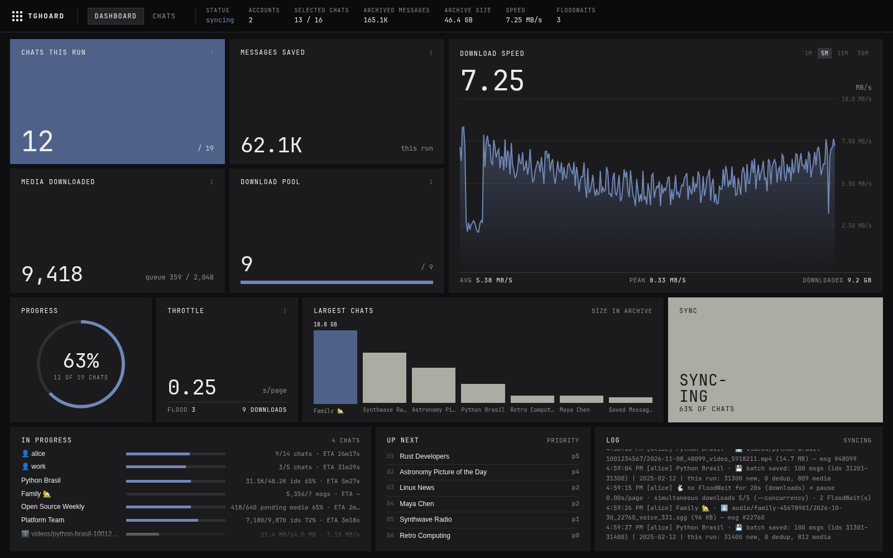
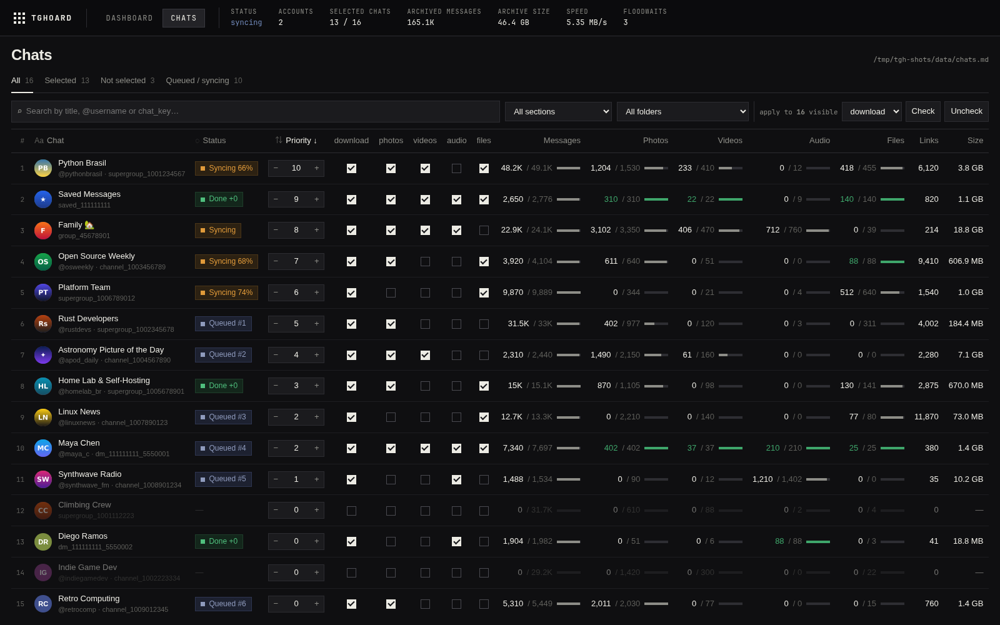

# telegram-datahoarding (`tghoard`)

A personal Telegram archiver driven by the **CLI**: it saves messages, media, links and metadata from one or more accounts as **plain-text files** (JSON + Markdown) organized by category, with **SQLite checkpoints** (resumes where it left off) and **cross-account deduplication**. An **optional local web UI** helps you pick chats and follow progress — everything also works from the CLI alone.

## Highlights

- **You choose what to download** in `chats.md` — per chat: `[x] baixar | [ ] photos | [ ] videos | [ ] audio | [ ] files | prioridade: 0`. Re-running `tghoard start` never erases your selections.
  - `chats.md` keeps its Portuguese tokens (`baixar` = download this chat, `prioridade` = priority, section headings such as `## Grupos e Supergrupos`) for compatibility with existing files.
- **Predictable plain text**: messages in `messages/<chat>/YYYY-MM-ptNNN.json` (one file per month, split into parts of up to 1 MB), media in per-type folders, `links/` and `metadata/` in Markdown. Easy to read, version, `grep` or process with scripts.
- **Nothing gets lost**: messages deleted on Telegram stay archived and are flagged (`is_deleted`); edits keep the previous text in `revisions`.
- **Robust and fast**: resumes after `Ctrl+C`, network drops, Telegram 500 errors and `FloodWait`; failed downloads are retried on the next sync; several chats in parallel (`-j`) and a per-account download pool whose parallelism tunes itself to Telegram's FloodWaits.
- **Multi-account without re-downloading**: groups/channels shared between your accounts use the same folder, and whatever one account already downloaded is not downloaded again.
- **Web UI**: select chats and set priorities (they take effect even during a sync), each chat's photo, **downloaded / total on Telegram** (messages, photos, videos, audio, files), the date you joined, a filter by **your Telegram folders**, per-column sorting and progress bars.
- **Telegram folders**: saved to `folders.md`; `tghoard folder-links` generates the links of every chat in each folder.

## Web UI

Opened by `tghoard sync` (or on its own with `tghoard web`). It's optional: everything it does is editing `chats.md`, which you can also do by hand. *(Screenshots use made-up demo data.)*

**Dashboard** — live progress of the sync: chats and messages this run, download speed, the download pool and auto-throttle, chats in progress, the priority queue and the log.



**Chats** — the `chats.md` editor: check what to download per chat, set priorities, filter by section or Telegram folder, and compare what's archived with the totals on Telegram.



## Quick start

**Requirements**: Linux/macOS, Python ≥ 3.11 (or [`uv`](https://docs.astral.sh/uv/), which downloads Python by itself) and a Telegram `api_id`/`api_hash`, created at <https://my.telegram.org> → *API development tools*.

```bash
# 1. Set up the environment (venv + dependencies) and create .env from .env.example
./tghoard.sh --help

# 2. Fill in TG_API_ID and TG_API_HASH in .env (and, optionally, TGHOARD_DATA_DIR; default ./data)

# 3. Log in to Telegram (phone, code and 2FA password) and generate chats.md
./tghoard.sh start

# 4. Sync — the web UI opens in the browser so you can pick the chats
./tghoard.sh sync
```

`tghoard.sh` installs/updates the environment by itself and forwards any argument to the CLI (`./tghoard.sh <command>` is the same as `tghoard <command>`).

- Prefer the terminal only? Run `./tghoard.sh sync --no-web` and edit `chats.md` by hand.
- With no chats selected (or once the queue is finished), the sync **waits for Enter** (or the web UI's *Start sync* button) to run again; `q` + Enter exits. Outside a terminal (cron, pipe) it runs once and exits.
- On the first sync of a new session Telegram usually holds back *Takeout* mode for 24h; `tghoard` automatically carries on in standard mode.

### Second account

```bash
./tghoard.sh start --add-account --alias trabalho   # log in + add its chats to chats.md
./tghoard.sh sync                                   # the accounts sync in parallel
```

## Where the data lives

```text
<data_dir>/                      (TGHOARD_DATA_DIR, default ./data)
├── chats.md                     what to download (checkboxes + priority)
├── folders.md                   your Telegram folders, per account
├── messages/python-brasil-1234567890/2026-11-pt000.json
├── photos/python-brasil-1234567890/
├── videos/  audio/  files/      (created only once something is downloaded)
├── links/python-brasil-1234567890.md
├── metadata/python-brasil-1234567890/   info.md, members.md, stories.md, deleted_and_edits.md, …
└── .tghoard/                    internal state: checkpoint.db, sessions, web UI cache
```

Each chat has a `<kebab-case-title>-<id>` folder; renaming the chat on Telegram does not change the folder.

## Commands

| Command | What it does |
|---|---|
| `start [--add-account --alias X]` | Log in and create/update `chats.md` (+ `folders.md`) |
| `sync [-j N] [-a account] [-c chat] [--since YYYY-MM-DD] [-v] [--no-web]` | Download messages, media, links and metadata |
| `web` | Web UI only (edit `chats.md`, view statistics), without connecting to Telegram |
| `watch [-a account]` | Real-time listener (edits, deletions, presence) |
| `search TEXT [-c chat] [--deleted] [--edited] [--links]` | Search the archive's JSON files |
| `stats` | Archive statistics |
| `folder-links [-f md\|txt\|csv] [--only-public] [--only-channels]` | Links of the chats in each Telegram folder |
| `verify-media [--hash] [--fix]` | Check that every media item in the JSON files is on disk (size/SHA-256) or queued; `--fix` re-queues what is missing |
| `account list \| add \| remove` | Manage accounts |
| `migrate [--apply]` | Upgrade an old archive to the current layout (shows the plan without `--apply`) |
| `rebuild-checkpoint`, `rebuild-md` | Rebuild the internal database / the Markdown files from the JSON files |

Full reference (options and `.env` variables): [`documentation/cli-reference.md`](./documentation/cli-reference.md).

Only one command at a time can write to an archive (`sync`, `start`, `watch`, `migrate --apply`, …): a second one exits right away saying which command holds `.tghoard/archive.lock`. Read-only commands (`web`, `search`, `stats`, `verify-media`, `folder-links`) can run alongside a sync.

### Upgrading an old archive

Archives created before the per-category layout (`<chat_key>__<name>/chats/…` folders) must be migrated once; commands that read the archive warn you when that is the case:

```bash
./tghoard.sh migrate          # show the plan (changes nothing)
./tghoard.sh migrate --apply  # move the files (rename, no copy), group the JSON files by month and update the database
```

The migration backs up `checkpoint.db`, can be resumed if interrupted and, at the end, removes the empty folders.

## Privacy and security

- Everything stays on your machine, in `TGHOARD_DATA_DIR`. The Telegram sessions (`.tghoard/sessions/`) are equivalent to a login: treat them like passwords. tghoard creates them `0600` (folder `0700`) and **warns at every connection if the filesystem doesn't honor that** — typical of exFAT/NTFS external drives, where anyone with access to the drive could copy your session.
- `.env`, `/data/`, sessions (`*.session`) and databases (`*.db`) are in `.gitignore` — never commit these files (with a `TGHOARD_DATA_DIR` outside the repository, such as an external drive, they never even pass through it).
- The web UI listens only on `127.0.0.1`, rejects requests addressed to other host names (DNS rebinding), writes without its own header (CSRF) and API requests coming from other sites, and only modifies `chats.md`. It has no password: other users of the same machine could reach it while it is open.
- Everything that comes from Telegram (chat titles, names, bios, file names) is treated as untrusted: it can't change your `chats.md` selections, forge a chat's folder identity, inject terminal markup or escape the archive folders.

## Development

```bash
.venv/bin/pytest -q              # tests
.venv/bin/ruff check src tests   # lint
```

Architecture, formats and project rules: [`documentation/`](./documentation/) ([architecture](./documentation/architecture.md), [data formats](./documentation/data-formats.md), [multi-account](./documentation/multi-account-and-dedup.md), [CLI](./documentation/cli-reference.md)) and [`AGENTS.md`](./AGENTS.md).
