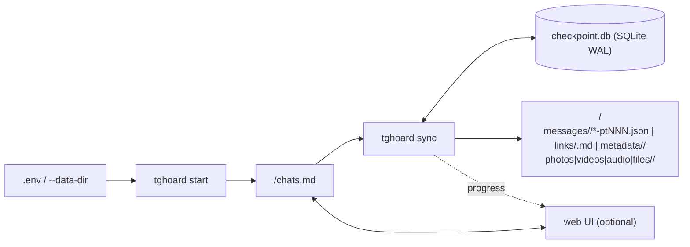

# `tghoard` Architecture

`tghoard` uses a **two-layer** model designed to combine maximum human readability with transactional reliability on large archives:

1. **Plain-Text Archive Layer (per-category layout)**:
   - All data captured from Telegram (messages, edit revisions, preserved deleted messages, links and rich metadata) is written directly to indented `.json` files and readable `.md` files: `messages/<folder>/YYYY-MM-ptNNN.json`, `links/<folder>.md`, `metadata/<folder>/*.md`, with the media in `photos/<folder>/`, `videos/<folder>/`, `audio/<folder>/` and `files/<folder>/` (`<folder>` = `kebab-title-<id>`).
   - Each folder's identity lives in `metadata/<folder>/info.md` (`` (`<chat_key>`) `` on the first line), so the layout is self-describing and rebuildable.
   - No binary database is needed to read the archive, search it with `grep`/`jq` or process it with your own scripts.

2. **Internal Checkpoint and Deduplication Layer (`<data_dir>/.tghoard/`)**:
   - A lightweight SQLite database in `WAL` mode (`checkpoint.db`) stores only pagination cursors, ranges already synced across multiple accounts (`chat_synced_ranges`), `PTS`/`QTS` state for offline replay of deletions and edits, the pending media queue (`pending_media`) and the global media index (`media_index`).
   - Authenticated Telethon sessions live in `<data_dir>/.tghoard/sessions/<account_id>.session` with `0600` permissions, preserving MTProto's native `access_hash` cache for entities.

## Execution Flow

### 1. `tghoard start`
- Connects to the authenticated accounts (or starts the interactive login flow if no account is registered or if `--add-account` is used).
- Enumerates all dialogs (`iter_dialogs`), groups groups/channels shared between accounts under the same canonical `chat_key` and writes `<data_dir>/chats.md`.
- Every re-run of `tghoard start` performs a **non-destructive merge**: it fully preserves the `[x]`/`[ ]` selections the user already made for known chats and only adds new dialogs with the default `[x] baixar | [ ] photos | [ ] videos | [ ] audio | [ ] files`.

### 2. `tghoard sync`
For each registered account and each chat with `[x] baixar` (download) checked in `<data_dir>/chats.md`, in order of **`prioridade`** (priority; highest first). The queue is recomputed from `chats.md` (re-read only when it changes on disk) whenever a worker becomes free, so priorities/checkboxes changed during the sync — through the web UI or by hand — apply to the chats not started yet:
1. **Takeout Session / Throttling (`--mode auto`)**: tries to open `account.initTakeoutSession` for relaxed rate limits; if Telegram requires a security waiting period (`TakeoutInitDelayError`), it automatically falls back to standard synchronization with adaptive rate control and automatic waiting on `FloodWaitError`. A Takeout session left open by a run that died inside it (killed, crash, power loss) stays recorded in the account's `.session` file; the next sync closes it first and starts a fresh one, and errors raised by the sync itself always propagate instead of being taken for "Takeout unavailable". Each chat is an idempotent unit: transient errors (`ServerError` 500, timeouts) trigger a new attempt with backoff that resumes from the checkpoint; persistent failures — of any kind: network, a corrupt JSON part, an I/O or SQLite error — skip only that chat (`OrchestratorStats.failed_chats`; exit code 1, resumed on the next sync). Losing an account's authorization (`UnauthorizedError`/`AuthKeyError`) stops only that account (`failed_accounts`); the others carry on. Storage failures stop the whole run with a clear message (`ArchiveStorageError`): disk full, read-only filesystem, quota, or a write probe in `.tghoard/` that fails (e.g. the external drive was unplugged) — continuing would only fail every chat while spending Telegram requests. A failing `PTS` replay is a warning, not a fatal error.

**Performance**: (a) history is paginated without Telethon's fixed 1 s pause; each account's pause and parallelism are tuned online by a `FloodController` (`telegram/flood_control.py`) based on FloodWaits — the short ones, which Telethon sleeps through silently, arrive via a log handler on each client's own `base_logger` (`tghoard.tg.<account_id>`); the long ones via `RateLimiter`/`retry_transient` (each FloodWait is counted once). FloodWaits are classified by request: only file requests (`GetFileRequest`, `GetCdnFileRequest`, …) cut the download parallelism (× `TGHOARD_THROTTLE_CUT_RATIO`, at most once every 3 s so a burst of parallel workers counts as one event); any other request (history, `GetMessages`, metadata) doubles the pause between pages instead. The pause and the parallelism recover on independent timers (every `TGHOARD_THROTTLE_RECOVER_SECS` without a FloodWait of their own kind: pause halved, parallelism +1). The `RateLimiter` holds a fixed number of API slots (`TGHOARD_CONCURRENCY`, FIFO-fair `DynamicSlots`) that do **not** follow download cuts, sleeps its jitter before taking a slot, and treats the `CancelledError` Telethon raises on in-flight requests when a connection drops (not a real cancellation: `current_task().cancelling() == 0`) as a transient `ConnectionError`, retried with backoff; (b) media is downloaded by a **per-account download pool** (`sync/media_pool.py`): `TGHOARD_CONCURRENCY` fixed workers consuming a bounded channel (`asyncio.Queue`), shared by all of the account's chats — no task per file. The message reader sends each download to the channel (and waits if it is full: *backpressure*) and keeps reading; each batch is only written/checkpointed after its media has finished. The number of active workers follows the auto-throttle; downloads do not take `RateLimiter` slots (API calls never wait behind downloads). If a chat aborts, `cancel_group` cancels only its downloads, and the workers keep serving the others; (c) `ChatPartWriter` keeps a cache of the parts already read (validated by inode/mtime/size), only rewrites the parts whose content changed (just the last one on chronological appends) and writes them in a crash-safe order — a message's new part is durably on disk before its old part is overwritten, so an interruption can duplicate a message across two parts (merged on read, cleaned by the next write) but never lose one; the backfill of DMs/Saved Messages (newest to oldest) writes when the month changes or every 1000 messages, instead of every 100.

**Fast resume**: each batch checkpoints the contiguous range `[start of range, highest id in batch]` (ids missing in between are deleted messages — the iterator has already gone past them), so no "gaps" are left to re-check on every restart. Small internal gaps (from earlier versions, or deleted messages) are resolved in bulk with `get_messages(ids=…)`, 100 ids per request, and recorded with an incremental range merge (one indexed transaction per request — tens of thousands of holes close in well under a second without stalling the event loop). **History ends are verified**: Telethon's iterator can stop early on a bad connection (empty page, duplicated ids), so a range is only checkpointed up to the highest id actually seen; the rest is checked by id (≤ 1000 ids) or probed with `get_messages(limit=1, …)` before being marked covered. A DM/Saved/basic-group backfill is only marked complete after a probe confirms nothing older exists, and new messages in those chats are fetched from a **forward cursor owned by `sync`** (`chat_account_cursors.forward_max_id`) — never from the highest id any writer recorded, so a message stored by `watch` can't hide the ones missed before it. (Upgrading from a version without that cursor walks each such chat's history once, fetching pages only.) Each chat's metadata is refreshed at most every `TGHOARD_METADATA_EVERY_HOURS`; `links.md`/`deleted_and_edits.md` are rebuilt in a worker thread. Draining pending media is a continuous pipeline: the queue is read in pages of 1000 (constant memory even with millions of rows), messages are re-fetched 100 at a time to renew the `file_reference`, the pool is kept full, and finished files are recorded in **batches** — each JSON part is rewritten once per flush (every 500 files, 5 s, or when downloads pause) and only then are the queue rows marked done, in one transaction.

**`sync` parallelism**: accounts run in parallel, each with its own `RateLimiter` (FloodWait limits are per account), and within each account up to `TGHOARD_PARALLEL_CHATS` chats sync simultaneously. Guarantees: (a) a lock per `chat_key` — two accounts never sync the same shared chat at the same time, preserving `chat_synced_ranges`; (b) a lock per media item `(tg_type, tg_id)` in `MediaManager` — the same media in parallel chats is downloaded only once and reused via hardlink; (c) all writes to SQLite and to the JSON/Markdown files are synchronous (no `await` in the middle of transactions or read-modify-write), and therefore atomic on the single-threaded event loop.
2. **Offline `PTS` Replay (`pts_diff.py`)**: queries `updates.getDifference` and `updates.getChannelDifference` from the account's last saved `pts` to capture deleted (`UpdateDeleteMessages`) and edited (`UpdateEditMessage`) messages while the client was offline.
3. **Incremental Message Sync (`messages_sync.py`)**: computes only the ranges not yet synced by any account (`missing_ranges`), processes them in short batches (100 messages per page), writes to the `messages/<folder>/YYYY-MM-ptNNN.json` files, updates `links/<folder>.md` and atomically commits the checkpoint to SQLite after each batch.
4. **Retroactive Media Draining (`pending_media`)**: if the user enabled `[x] photos`, `[x] videos`, `[x] audio` or `[x] files` for a chat whose messages had already been downloaded, `tghoard` fetches only the pending media of that category and fills in the `"path"` field in the corresponding JSON files. The same queue holds **failed downloads**: a failing attachment (exception, empty file) never aborts the chat — the message is written with `media.skip_reason = "download_failed"` / `"empty_download"`, the media goes into `pending_media` (columns `attempts` and `last_error`) and is retried on every `sync`, re-fetching the message to get a fresh `file_reference`. Permanent failures (message or media gone from the server, media no longer downloadable) back off after 3 attempts — retried after 1, 2, 4 … days, at most every 30 days (`retry_after`) — and stay visible in `verify-media` and the stats. Attachments above `TGHOARD_MAX_MEDIA_MB` (`"exceeds_max_media_mb"`) also stay in the queue, at no RPC cost, and are downloaded when the limit is raised. On completion, `skip_reason` is removed and `downloaded/path/sha256` are filled in.
5. **Metadata, Stories, Admin Log and Presence (`metadata_sync.py`)**: updates all the reports in `metadata/<folder>/*.md` (including active Stories before they expire after 24h and recovery of messages deleted in the last 48h via `channels.getAdminLog` where the account has admin rights).

## Atomic Writes and Recovery

- All `.json` and `.md` files are written to a temporary file in the same directory followed by `os.replace`, preventing truncated files if the process receives `SIGINT` (`Ctrl+C`) or loses power.
- If `checkpoint.db` is deleted or the user moves only the plain-text folders to another machine, the `tghoard rebuild-checkpoint` command rebuilds the index database by scanning `messages/*/*-pt*.json` and the attachment folders: message/media indexes, synced ranges built from the ids actually present (never papering over gaps) and the queue of media not downloaded yet.
- **Single writer**: every command that writes to the archive (`start`, `sync`, `watch`, `account add`/`remove`, `migrate --apply`, `verify-media --fix`, `rebuild-*`) takes an exclusive, non-blocking `flock` on `.tghoard/archive.lock` (`storage/process_lock.py`). A second writer exits immediately (code 3) naming the holder's command and pid, instead of racing on the same JSON parts and checkpoint rows. The lock dies with the process, so a crash never leaves a stale lock. Read-only commands (`web`, `search`, `stats`, `verify-media` without `--fix`, `folder-links`, `migrate` without `--apply`) don't take it.
- **Downloads interrupted mid-way** are written to a `.dl_*` temporary file, hashed and **fsynced**, and only renamed into place once complete; a document whose size differs from the one Telegram declared counts as `download_failed`. A dropped connection is retried and, if it keeps failing, fails just that download (it goes back to `pending_media`) — the chat and the pool worker carry on. Stale `.dl_*` leftovers (older than 15 min, e.g. after a power loss) are removed the first time a run writes into that folder. Dedup and "already on disk" checks trust a file only if it has exactly the indexed size, so a truncated file is downloaded again.
- **Media vs. JSON consistency**: `tghoard verify-media` checks every media item the JSON files reference against the disk (size, optionally SHA-256) and the queue; `--fix` re-queues what is missing or corrupt.

## Web UI (optional)

- `src/tghoard/web/server.py`: stdlib HTTP server, in its own thread, **on `127.0.0.1` only**; rejects external `Host` headers (DNS rebinding), requires the `X-Tghoard` header on writes (CSRF) and refuses API/avatar requests that browsers mark `Sec-Fetch-Site: cross-site`/`same-site` (so another page can't probe your chats or trigger Telegram calls via ``). It has no login: any local user can reach the loopback port. Edits `chats.md` via `update_chat_selections` (lock + atomic write) — it never keeps state of its own.
- `src/tghoard/sync/live_state.py`: thread-safe `LiveSyncState` fed by the sync's progress "bars" (each `BarHandle` forwards to the web UI sinks; the terminal shows only logs), plus the recent log and the priority queue. The *Start sync* button wakes up the CLI's `wait_for_user` via `call_soon_threadsafe`.
- `src/tghoard/web/telegram_bridge.py`: Telegram calls made by the web UI on the sync's event loop via `run_coroutine_threadsafe` — chat photos (small `download_profile_photo`, cached in `.tghoard/avatars/`) and server-side totals (`messages.getHistory` + `messages.getSearchCounters`, 6 h cache in `.tghoard/remote_counts.json`), both on demand for the visible rows.
- Statistics (`storage/chat_stats.py`): one grouped query per table in SQLite (read-only connection) + `scandir` per category. The download queue (`pending_media`) is grouped by chat and category with the sizes of its items, which gives the exact space still needed for archived messages and what the size limit is holding back (`/api/oversized`, the *Too large* button); history not archived yet is estimated from the totals on Telegram × the average size. The same functions back `tghoard stats --to-download` / `--too-large`. They are served *stale-while-revalidate*: requests always get the last computed value immediately and, when it is older than 15 s, a single background thread recomputes it — a slow external drive never blocks the page.
- `static/index.html` is read from disk on every request (no restart needed after an update); everything the page shows is in English, while the generated archive files keep their Portuguese labels (see `data-formats.md`).

## Archive Migrations

Layout changes live in `src/tghoard/migrations/mNNNN_*.py` (each with `is_needed`, a read-only `plan` and a resumable `apply`). `tghoard migrate` shows the plan; `--apply` runs it, backs up `checkpoint.db` to `.tghoard/backups/` and records it in `.tghoard/migrations.json`. Commands that read/write the archive refuse to run while a migration is pending, avoiding mixed layouts.
