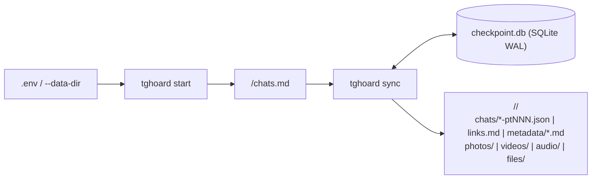

# Arquitetura do `tghoard`

O `tghoard` adota um modelo em **duas camadas** pensado para unir máxima legibilidade humana com confiabilidade transacional em acervos grandes:

1. **Camada de Acervo Plain-Text (`<data_dir>/<chat_folder>/`)**:
   - Todo dado capturado do Telegram (mensagens, revisões de edições, mensagens apagadas preservadas, links e metadados ricos) é gravado diretamente em arquivos `.json` indentados e `.md` legíveis no sistema de arquivos, acompanhados das mídias organizadas em `photos/`, `videos/`, `audio/` e `files/`.
   - Nenhum banco binário é necessário para ler, pesquisar com `grep`/`jq` ou processar o acervo com scripts próprios.

2. **Camada Interna de Checkpoints e Deduplicação (`<data_dir>/.tghoard/`)**:
   - Um banco leve SQLite em modo `WAL` (`checkpoint.db`) guarda apenas cursores de paginação, intervalos já sincronizados entre múltiplas contas (`chat_synced_ranges`), estado `PTS`/`QTS` para replay offline de deleções e edições, fila de mídias pendentes (`pending_media`) e índice global de mídias (`media_index`).
   - As sessões autenticadas do Telethon ficam em `<data_dir>/.tghoard/sessions/<account_id>.session` com permissão `0600`, preservando o cache nativo de `access_hash` das entidades do MTProto.

## Fluxo de Execução

### 1. `tghoard start`
- Conecta nas contas autenticadas (ou inicia o fluxo interativo de login se nenhuma conta estiver cadastrada ou se `--add-account` for usado).
- Enumera todos os diálogos (`iter_dialogs`), agrupa grupos/canais compartilhados entre contas sob o mesmo `chat_key` canônico e grava `<data_dir>/chats.md`.
- Toda reexecução de `tghoard start` faz **merge não-destrutivo**: preserva integralmente as marcações `[x]`/`[ ]` já feitas pelo usuário nos chats conhecidos e adiciona apenas novos diálogos com o padrão `[x] baixar | [ ] photos | [ ] videos | [ ] audio | [ ] files`.

### 2. `tghoard sync`
Para cada conta cadastrada e cada chat com `[x] baixar` marcado em `<data_dir>/chats.md`:
1. **Sessão Takeout / Throttling (`--mode auto`)**: tenta abrir `account.initTakeoutSession` para limites de taxa relaxados; se o Telegram exigir período de espera de segurança (`TakeoutInitDelayError`), cai automaticamente para sincronização padrão com controle adaptativo de taxa e espera automática em `FloodWaitError`.
2. **Replay Offline de `PTS` (`pts_diff.py`)**: consulta `updates.getDifference` e `updates.getChannelDifference` a partir do último `pts` salvo da conta para capturar mensagens apagadas (`UpdateDeleteMessages`) e editadas (`UpdateEditMessage`) enquanto o cliente estava desligado.
3. **Sincronização Incremental de Mensagens (`messages_sync.py`)**: calcula apenas os intervalos ainda não sincronizados por nenhuma conta (`missing_ranges`), processa em lotes curtos (100 mensagens por página), grava nos arquivos `chats/YYYY-MM-DD-ptNNN.json`, atualiza `links.md` e faz commit atômico do checkpoint no SQLite a cada lote.
4. **Drenagem Retroativa de Mídias (`pending_media`)**: se o usuário habilitou `[x] photos`, `[x] videos`, `[x] audio` ou `[x] files` em um chat cujas mensagens já haviam sido baixadas antes, o `tghoard` busca apenas as mídias pendentes daquela categoria e preenche o campo `"path"` nos JSONs correspondentes.
5. **Metadados, Stories, Admin Log e Presença (`metadata_sync.py`)**: atualiza todos os relatórios em `metadata/*.md` (incluindo Stories ativos antes de expirarem em 24h e recuperação de mensagens apagadas nas últimas 48h via `channels.getAdminLog` onde a conta tiver permissão de admin).

## Escrita Atômica e Recuperação

- Todos os arquivos `.json` e `.md` são gravados via escrita em arquivo temporário no mesmo diretório seguida de `os.replace`, impedindo arquivos truncados caso o processo receba `SIGINT` (`Ctrl+C`) ou queda de energia.
- Caso `checkpoint.db` seja removido ou o usuário mova apenas as pastas plain-text para outra máquina, o comando `tghoard rebuild-checkpoint` reconstrói o banco de índices varrendo `chats/*-pt*.json` e as pastas de anexos.
